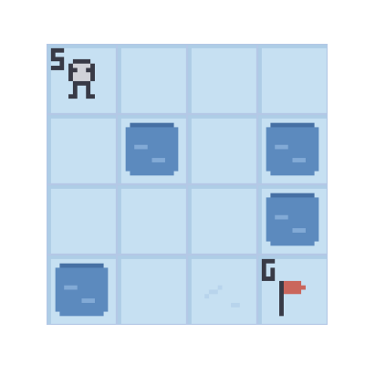
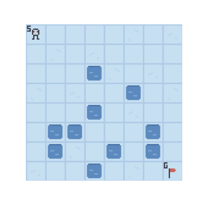
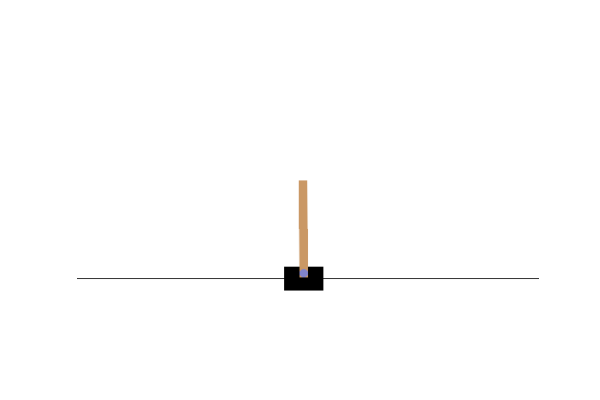
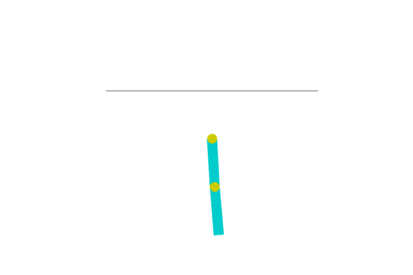
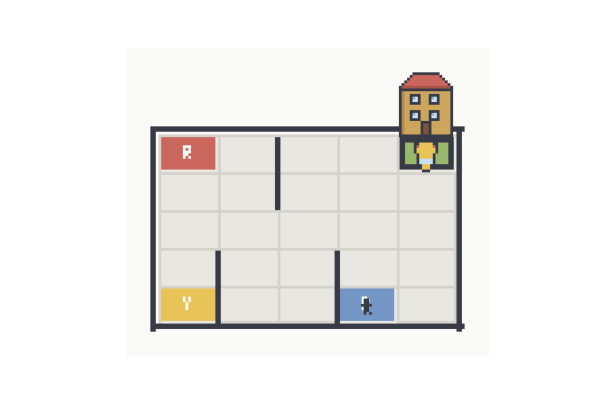
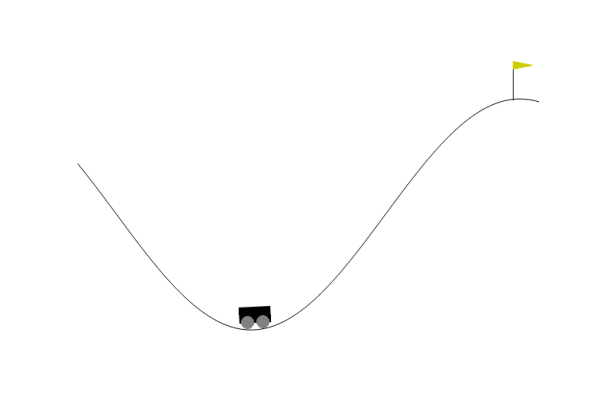
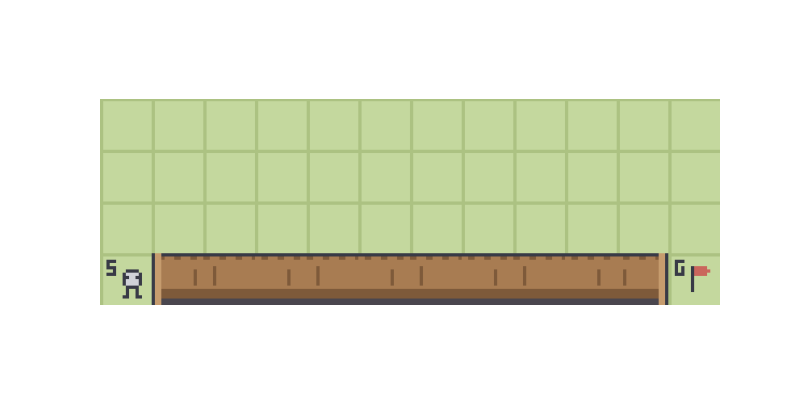
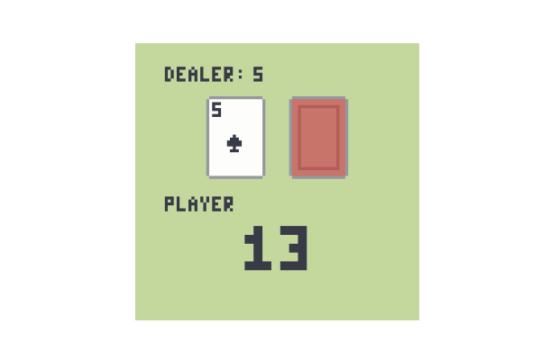
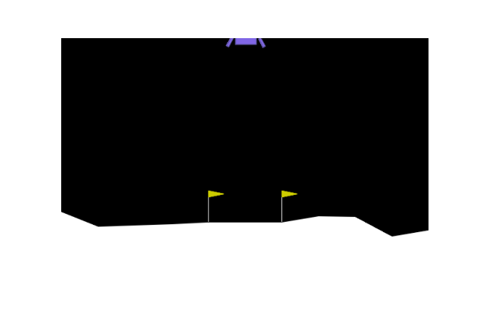

# Deep Q-Learning Networks

Deep Q-Learning Network (DQNs) is a method to learn optimal action-selection policies directly from high-dimensional sensory inputs.

## Installation

```console
git clone https://github.com/bareform/dependencies.git
conda update -n base -c defaults conda
conda env create -f dependencies/environment.yml
conda activate bareform

git clone https://github.com/bareform/dqn.git
cd dqn
```

<details>
  <summary> Dependencies (click to expand) </summary>
  
  ## Dependencies
  - Python 3.10
  - gymnasium
  - pygame
  - numpy
  - torch

`LunarLander-v3` additionally requires Gymnasium's Box2D dependencies:

```console
pip install "gymnasium[box2d]"
```
    
</details>

## Quick Start

To train a `FrozenLake-v1-4x4` DQN:

```
python3 -m utils.trainer --config="./configs/frozenlake-v1-4x4.toml"
```

After training for 100000 steps, you can find results similiar to the gif at `./assets/frozenlake-v1/frozenlake-v1-4x4.gif`:



To train a `FrozenLake-v1-8x8` DQN:

```
python3 -m utils.trainer --config="./configs/frozenlake-v1-8x8.toml"
```

After training for 500000 steps, you can find results similiar to the gif at `./assets/frozenlake-v1/frozenlake-v1-8x8.gif`:



To train a `CartPole-v1` DQN:

```
python3 -m utils.trainer --config="./configs/cartpole-v1.toml"
```

After training for 100000 steps, you can find results similiar to the gif at `./assets/cartpole-v1/cartpole-v1.gif`:



To train an `Acrobot-v1` DQN:

```
python3 -m utils.trainer --config="./configs/acrobot-v1.toml"
```

After training for 300000 steps, you can find results similiar to the gif at `./assets/acrobot-v1/acrobot-v1.gif`:



To train a `Taxi-v4` DQN:

```
python3 -m utils.trainer --config="./configs/taxi-v4.toml"
```
After training for 500000 steps, you can find results similiar to the gif at `./assets/taxi-v4/taxi-v4.gif`:



To train a `MountainCar-v0` DQN:

```
python3 -m utils.trainer --config="./configs/mountaincar-v0.toml"
```

After training for 120000 steps, you can find results similiar to the gif at `./assets/mountaincar-v0/mountaincar-v0.gif`:



To train a `CliffWalking-v1` DQN:

```
python3 -m utils.trainer --config="./configs/cliffwalking-v1.toml"
```

After training for 100000 steps, you can find results similiar to the gif at `./assets/cliffwalking-v1/cliffwalking-v1.gif`:



To train a `Pendulum-v1` DQN:

```
python3 -m utils.trainer --config="./configs/pendulum-v1.toml"
```

After training for 300000 steps, you can find results similar to the gif at `./assets/pendulum-v1/pendulum-v1.gif`:


To train a `Blackjack-v1` DQN:

```
python3 -m utils.trainer --config="./configs/blackjack-v1.toml"
```

After training for 300000 steps, you can find results similar to the GIF at `./assets/blackjack-v1/blackjack-v1.gif`:



To train a `LunarLander-v3` DQN:

```console
python3 -m utils.trainer --config="./configs/lunarlander-v3.toml"
```

After training for 500000 steps, you can find results similar to the GIF at
`./assets/lunarlander-v3/lunarlander-v3.gif`:



You can download the pre-trained models [here](https://huggingface.co/luethan2025/dqn) and use the provided Jupyter Notebook `inference.ipynb` to visualize the agents.

## Method

[Playing Atari with Deep Reinforcement Learning](https://arxiv.org/pdf/1312.5602)

Volodymyr Mnih, Koray Kavukcuoglu, David Silver, Alex Graves, Ioannis Antonoglou, Daan Wierstra, Martin Riedmiller

DeepMind

> We present the first deep learning model to successfully learn control policies directly from high-dimensional sensory input using reinforcement learning. The model is a convolutional neural network, trained with a variant of Q-learning, whose input is raw pixels and whose output is a value function estimating future rewards. We apply our method to seven Atari 2600 games from the Arcade Learning Environment, with no adjustment of the architecture or learning algorithm. We find that it outperforms all previous approaches on six of the games and surpasses a human expert on three of them.

## Citation

The original paper can be found at:
```
@misc{mnih2013dqn,
    title={Playing Atari with Deep Reinforcement Learning},
    author={Volodymyr Mnih and Koray Kavukcuoglu and David Silver and Alex Graves and Ioannis Antonoglou and Daan Wierstra and Martin Riedmiller},
    year={2013},
    eprint={1312.5602},
    archivePrefix={arXiv},
    primaryClass={cs.LG}
}
```
